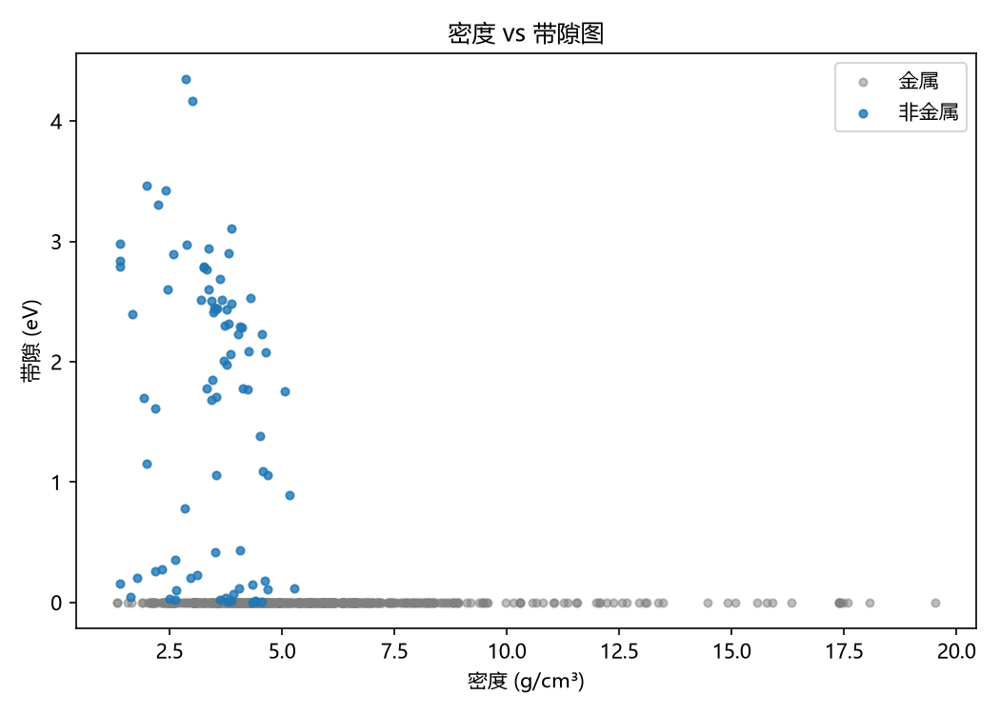
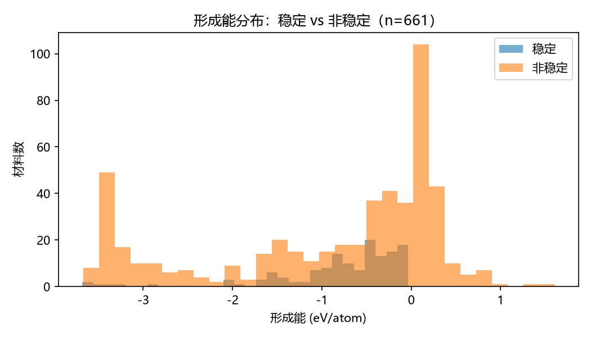
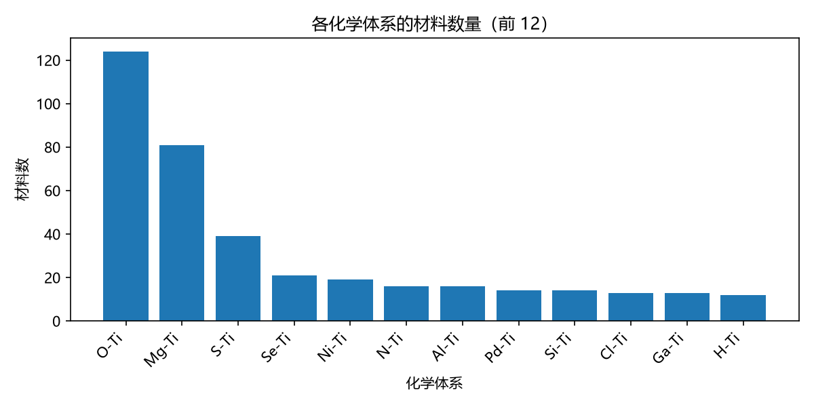

# 钛的二元化合物：一份数据画像

> 作者：士莎比亚
> 数据：Materials Project API，抓取日期 2026-10-26
> 代码：fetch_mp.py / analysis.py

## 数据

- 来源：Materials Project API，2026-10-26 抓取
- 查询：`elements=Ti`、`nelements_max=2`，命中 673 条
- 清洗：删 10 条纯钛（nelements=1）+ 2 条密度异常（TiS 0.02、Ti3S4 0.51 g/cm³）
  → 661 条、70 个体系、15 个字段

## 发现

1. 金属性：87.3%（577/661）是金属。84 个非金属里，氧化物 O-Ti 占 59 个；
   非金属带隙中位数 1.81 eV（n=84），最宽的是 TiF4（两种结构，4.35 / 4.17 eV）
   和 TiCl4（3.46 eV），前三名都是卤化物（图 1）。
2. 稳定性：只有 21.0%（139/661）在凸包上。
3. 密度：中位数 4.64 g/cm³，最轻 K3Ti（1.33），最重 TiPt8（19.54）。
4. 体系：O-Ti（124 条）、Mg-Ti（81 条）、S-Ti（39 条）材料最多；
   平均形成能最负的是 F-Ti（-3.24 eV/atom，n=10）、O-Ti（-2.95）、Cl-Ti（-2.03）。
5. 形成能：平均数与中位数给出相反趋势，原因见下。（图 2 中 0 附近的峰即来自 Mg-Ti）

## 一个反常识的点
> 平均数：非稳定 -0.937 vs 稳定 -0.789；中位数：非稳定 -0.373 vs 稳定 -0.547（n=522 / 139）。
> 根因是 Mg-Ti 的 81 条材料形成能为正（+0.01~+0.28）且全部非稳定，把平均数拉偏。
> 改用中位数后，稳定材料形成能更负。结论：形成能单独不能判断稳定性，要看凸包（energy_above_hull）。

## 局限

- DFT 带隙系统性低估（PBE/GGA+U）
- 只覆盖二元体系，没有三元、四元
- F-Ti 只有 10 条，“平均形成能最负”的结论样本太少
- 密度下限 1 g/cm³ 是经验判断，删掉的 2 条需人工复核
## 图

